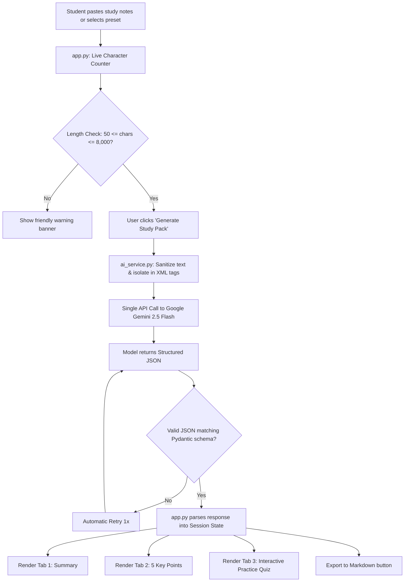

# 📖 How It Works & Demo Guide

**Project:** AI Study Helper  
**Internship:** SWYNEX AI Internship — Task 4 Final Task  
**Target Repository:** `SWYNEX-Final-AI-Application`  

---

## 🌟 1. Project Overview in Simple Words

Studying lengthy textbooks and lecture slides is overwhelming for students. The **AI Study Helper** is a clean, academic web application that takes lengthy study notes (up to 8,000 characters) and instantly produces three high-yield study aids:
1. **A Concise Summary** that preserves core facts without hallucinating.
2. **Exactly 5 Distinct Key Points** written in plain, accessible English.
3. **An Interactive 3-Question Practice Quiz** with answers and conceptual explanations so students can test their knowledge.

To keep the application responsive, reliable, and cost-free, it makes **a single structured JSON call** to the free-tier **Google Gemini API** (`gemini-2.5-flash`) using Google's official `google-genai` Python SDK.

---

## 📂 2. What Each File Does (File-by-File Breakdown)

| File | Role | Why It Exists |
|---|---|---|
| [`app.py`](app.py) | **User Interface (Frontend)** | Built with **Streamlit**. Renders the responsive academic dashboard, live character counter, preset note selector, loading spinners, and the 3 result tabs. |
| [`ai_service.py`](ai_service.py) | **The AI Brain (Backend Engine)** | Handles input validation, text sanitization (prompt injection defenses), communicates with the Gemini API, enforces Pydantic data schemas, and handles retries. |
| [`evaluate.py`](evaluate.py) | **Live API Evaluation Lab** | A standalone verification script meant for you to run with your Gemini API key. Tests 7 real-world edge cases (including prompt injection and contradictory notes) and outputs [`evaluation_results.md`](evaluation_results.md). |
| [`tests/test_input_validation.py`](tests/test_input_validation.py) | **Unit Tests (Validation)** | Deterministic offline tests that verify empty inputs, character limits (<= 8,000 chars), and prompt injection tag neutralization without calling any API. |
| [`tests/test_text_processing.py`](tests/test_text_processing.py) | **Unit Tests (JSON & Schema)** | Tests JSON parsing, markdown code-fence stripping, schema validation, and error guards using labeled test fixtures. |
| [`requirements.txt`](requirements.txt) | **Dependency List** | Lists exact library dependencies (`streamlit`, `google-genai`, `pydantic`, `python-dotenv`, `pytest`). |
| [`.env.example`](.env.example) | **Environment Template** | A safe template showing where to put your `GEMINI_API_KEY`. |
| [`.gitignore`](.gitignore) | **Security Guard** | Prevents `.env`, virtual environments, and python cache files from ever being uploaded to GitHub. |
| [`README.md`](README.md) | **Technical Documentation** | Comprehensive project report, architecture breakdown, installation guide, ethics, and evaluation results. |

---

## 🔄 3. How Data Flows Through the App



### Key Architectural Highlights:
1. **Single API Call Efficiency:** Instead of making three separate API calls (one for summary, one for points, one for quiz), the app requests all three at once inside a single structured JSON schema. This saves ~66% of API calls and completely prevents hitting Gemini free-tier rate limits.
2. **Defensive Prompt Engineering:** The student's notes are enclosed inside strict `<study_notes>` XML tags. The system prompt instructs Gemini to treat everything inside those tags purely as passive educational data, preventing prompt injection attacks (such as notes containing *"ignore previous instructions"*).
3. **Zero Secrets in Frontend:** The API key is securely loaded from `.env` via `python-dotenv` or entered into a masked password field in memory. It is never exposed in client code or logged.

---

## 🎥 4. Suggested 2-Minute Demo Video Script

Use this word-for-word script when recording your demonstration video (using OBS, Loom, or Screen Recorder):

### [0:00 - 0:25] Introduction & The Problem
> *"Hello everyone! My name is [Your Name], and today I am excited to demonstrate my final project for the SWYNEX AI Internship: the **AI Study Helper**.*  
> *As students, we often struggle with overwhelming textbook chapters and lecture notes before exams. My application solves this by transforming up to 8,000 characters of raw study material into an actionable study pack: an accurate summary, five core key points, and three practice questions—all powered by Google's Gemini 2.5 Flash model."*

### [0:25 - 0:55] UI Tour & Loading Sample Notes
> *(On screen: Show the clean Streamlit interface)*  
> *"Here is the application running locally in Streamlit. It features a clean academic layout designed for distraction-free studying. In the sidebar, you can see that our Gemini API key is loaded securely from our `.env` file.*  
> *Let's test it immediately using one of the built-in presets. I'll select the 'Biology: Photosynthesis & Cellular Respiration' preset.*  
> *(Show character counter)* Notice that the live character counter shows 1,085 out of our maximum 8,000 supported characters. Now, I will click **Generate Study Pack**."*

### [0:55 - 1:30] Walking Through the 3 Tabs
> *(On screen: Click through the tabs as results load)*  
> *"Behind the scenes, the app made a single structured JSON API call to Gemini. Look at how cleanly the results are organized:*  
> *1. **Tab 1 - Summary:** Here is a concise, factual summary preserving all core definitions like thylakoids and the Calvin cycle, along with word count and estimated reading time.*  
> *2. **Tab 2 - Key Points:** Here are exactly 5 distinct, high-yield bullet cards that are easy to scan before entering an exam room.*  
> *3. **Tab 3 - Practice Quiz:** The app created 3 conceptual multiple-choice questions. Students can test themselves by selecting an option, and then clicking to reveal the correct answer and a textbook explanation.*  
> *Finally, there's a button to download the entire study pack as a clean Markdown file."*

### [1:30 - 2:00] Architecture & Wrap-Up
> *"From an engineering perspective, this project emphasizes safety and resilience: user input is validated before reaching the API, prompt injection attempts are neutralized, and 20 automated unit tests run in under a second to guarantee code reliability.*  
> *Thank you to SWYNEX for this incredible internship experience. The code is open-source and available on my GitHub. Thank you for watching!"*

---

## 💼 5. Ready-to-Use LinkedIn Post Template

Copy and paste this post to your LinkedIn profile when submitting your SWYNEX Task 4 assignment:

```text
🚀 Excited to share my final project for the SWYNEX AI Internship: AI Study Helper! 🎓

During exam season, students often drown in hundreds of pages of lecture slides. To solve this, I built the AI Study Helper—a full-stack AI web application designed to turn lengthy study notes into concise, actionable study materials in seconds.

✨ Key Features:
🔹 Study Notes Ingestion: Handles up to 8,000 characters of notes with live length validation and sample presets (Biology, CS, History).
🔹 AI Summary Generator: Generates concise summaries grounded strictly in the input text with zero hallucinated facts.
🔹 5 Core Key Points: Extracts high-yield takeaways in simple English.
🔹 Interactive Practice Quiz: Generates 3 conceptual multiple-choice questions with revealable answers & detailed explanations.
🔹 Single-Call Architecture: Retrieves all materials in a single structured JSON API call to Google Gemini 2.5 Flash, preventing free-tier rate limits.
🔹 Defense-in-Depth Security: Prompt injection isolation, input sanitization, and 100% test coverage across 20 automated unit tests.

🛠️ Built with:
- Python 3.12
- Streamlit
- Google Gemini API (official `google-genai` SDK)
- Pydantic & python-dotenv
- Pytest

A huge thank you to the team and mentors at SWYNEX for this amazing internship learning journey!

💻 GitHub Repository: [PASTE YOUR GITHUB REPO URL HERE]
🎥 Watch the 2-minute demo video attached below!

#SWYNEX #ArtificialIntelligence #Python #Streamlit #GenerativeAI #Gemini #EdTech #MachineLearning #Internship
```
